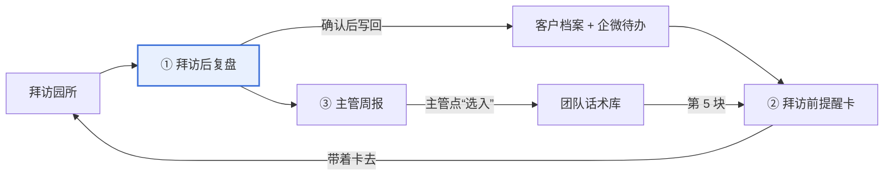

# AI 销售复盘助手

> **这是一个模拟的 AI 产品案例**，用来展示从问题定义、方案取舍、AI 能力设计到离线评测的完整思路。文中的公司“乐途智行”、产品“帮帮师记”“乐研小助”、园所、人名，以及所有上线时间和效果数据均为虚构。

**[打开可点击原型 »](https://xiaodan2048.github.io/sales-review-assistant/prototype/)**

一个 7 人销售团队的企业微信内部工具：拜访幼儿园后上传录音，约 3 分钟拿到复盘；复盘结论经销售确认后自动回到下次拜访前的提醒卡，好话术经主管筛选后回到每个人的卡上。

## 核心闭环



## 几个关键判断

| 判断 | 做法 |
| --- | --- |
| 小团队不值得单独装 App | 只做三个企微 H5 页面：上传复盘、提醒卡、周报 |
| AI 的结论必须能举证 | 每个分数、每条抽取都引用原话和时间戳；引用在转写里找不到就丢弃，没依据的维度不打分 |
| 幻觉不能污染客户档案 | AI 抽取只是候选，销售逐条点“对 / 改”后才写入 |
| 建议多了等于没有 | 只给 1 条亮点、1 条最该改的（内测时给 5 条，销售只看第一条） |
| 分数要被信任，就不能用来考核 | 周报不做排行榜；累计不满 20 条不出团队结论 |
| 先定上线线，再调 Prompt | 评分一致率 ≥ 80%、抽取准确率 ≥ 90%、召回率 ≥ 70%、原话可回溯率 100% |

## 评测结果【模拟】

20 段分层抽样的拜访录音，以销售主管评分为金标准：

| 指标 | 上线线 | v1 | v2（上线版） |
| --- | --- | --- | --- |
| 评分一致率（相差 ≤ 1 分） | ≥ 80% | 71% | **82%** |
| 抽取准确率 | ≥ 90% | 84% | **91%** |
| 抽取召回率 | ≥ 70% | 75% | **76%** |
| 原话可回溯率 | 100% | 93% | **100%** |

人和人之间（资深销售 vs 主管）的一致率是 85%，所以 82% 已接近上限。v1 → v2 的改动、逐条数据和坏例归因见[评测集与数据](docs/评测集与数据.md)。

运行 `python3 eval/check_metrics.py` 可以从逐条数据重新算出上面的数字。

## 仓库结构

```
├── docs/
│   ├── 产品方案.md          # 问题、用户、三条路径、取舍、AI 设计与合规、效果
│   └── 评测集与数据.md      # 评测集构成、金标准、v1/v2 结果、坏例归因、上线后监控
├── prompts/
│   ├── scoring.md           # 四维度评分 Prompt + 输出后规则校验 + v1→v2→v3
│   └── extraction.md        # 8 项关键信息抽取 Prompt
├── eval/
│   ├── scoring_v2.csv       # 20 段 × 4 维度的主管分与 AI 分
│   ├── extraction_v2.csv    # 8 个字段的抽取统计
│   └── check_metrics.py     # 从 CSV 重算评测指标
└── prototype/
    └── index.html           # 三个页面的可点击原型（纯前端，模拟数据）
```

Prompt 是根据方案中的评分细则整理的示意版本，不是生产代码。
