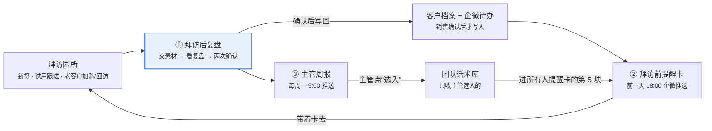

# AI 销售复盘助手

公司销售与客户成功团队的内部提效工具：拜访后上传录音，约 3 分钟拿到复盘和下一步，结论自动回到下次拜访前的提醒里。2025 年 11 月内部上线，7 人在用，挂在企业微信工作台，不另装 App。

## 为什么做

复盘靠手写，好打法留在老销售脑子里，主管看不到原话。帮帮师记 2025 年 8 月上线，9–11 月进入商业推广（老客户加购、集团集采、新拓单园），拜访量集中爆发；负责这条产品线的是 4 名销售、2 名客户成功和 1 名销售主管。

- **记录慢、还丢信息**：拜访后晚上凭回忆写进客户表，一次 30–40 分钟，常拖到第二天；园长提过的顾虑、还有谁要拍板，经常漏写。
- **经验不流动**：园长的典型顾虑（老师怕多一个负担、家长隐私、年度预算审批）每个人都会碰到，好的接法只在老销售那里，新人要跟访约 6 周才能独立跑。
- **主管看不见过程**：只能靠周会口头汇报判断拜访质量。

**为什么自己做，不买现成的会话分析工具：**

| 考虑 | 买现成 | 内部做 |
| --- | --- | --- |
| 成本 | 按席位年费，7 人团队摊下来不划算 | 复用帮帮师记已有的转写、结构化、原话溯源链路，只新增评分与抽取的 Prompt 和一个企微 H5 |
| 懂不懂园长 | 通用销售模型，不认识幼教采购链和园长顾虑 | 评分维度、顾虑分类按幼教场景定 |
| 能不能连自家数据 | 不能 | 能读这家园所在帮帮师记、乐研小助里的使用数据，老客户加购和上线回访时最有说服力 |
| 投入 | — | 1 名产品 + 1 名后端 + 1 名前端，4 周出 MVP |

## 用户与场景

三类角色、三类拜访，全部在企业微信里完成，没有单独的 App 或后台。

| 角色 | 人数 | 用它做什么 | 入口 |
| --- | --- | --- | --- |
| 销售 | 4 | 新签、试用跟进拜访后复盘；拜访前看提醒卡 | 企微工作台 H5、企微消息 |
| 客户成功 | 2 | 上线回访、活跃提升回访后复盘 | 同上 |
| 销售主管 | 1 | 每周一看团队周报，挑好话术进团队话术库 | 企微消息、H5 周报页 |

三类拜访用同一套复盘，提醒卡的重点不同：

- **新签**：找到真正拍板的人，问清预算什么时候审批。幼儿园的决策链通常是：园长、业务园长或保教主任（代表老师用不用）、举办者或集团（拍板和付款）。
- **试用跟进**：老师有没有真的在用，卡在哪一步。
- **老客户加购 / 上线回访**：用这家园所自己的使用数据说话，老师用得怎么样、卡在哪里。

## 核心路径一览

内圈是一个销售自己的闭环：复盘结论经确认写入档案，再变成下次拜访前的提醒卡。外圈把个人的好话术经主管筛选，送到所有人的提醒卡上。

## 路径一 · 拜访后复盘（核心）

销售从交素材到写回客户档案，6 步、约 8 分钟，其中人动手的只有交素材和两次确认。

| 步骤 | 销售做什么 / 看到什么 | 系统给什么 |
| --- | --- | --- |
| 1 进入 | 拜访结束 30 分钟后收到企微提醒“刚才在 XX 幼儿园的拜访，复盘一下？”，点开直达上传页；也可以从工作台主动进 | 从企微日程预填园所和拜访时间 |
| 2 交素材 | 三选一：上传录音 / 导入通话录音 / 按住口述 1–3 分钟；再选拜访类型（新签 / 试用跟进 / 老客户加购或回访） | 口述是没录音时的兜底 |
| 3 等待 | 看到“转写 → 分说话人 → 分析”三段进度，约 3 分钟；可以先关掉，好了会收到通知 | 复用帮帮师记的转写链路 |
| 4 看复盘 | 一屏读完：一句话结论与总分；四维度评分，每个分数展开是 1–2 句原话；做得好的 1 条；最该改的 1 条（原话 + 改写话术） | 做得好的那条可一键存入“我的话术” |
| 5 确认客户信息 | 系统从对话里抽出 8 项关键信息，每条带原话；销售逐条点“对 / 改” | 确认后才写回客户档案 |
| 6 确认下一步 | 系统列出对话里的承诺和建议动作（谁、做什么、哪天前），一键转成企微待办 | 同时生成下次拜访的提醒卡（路径二） |

三个设计取舍：

- **只给 1 条亮点、1 条最该改的**：内测时给 5 条建议，销售基本只看第一条。
- **AI 抽取只是候选，销售确认才入档**：和帮帮师记“AI 提候选、人做判断”是同一个原则，避免幻觉直接污染客户档案。
- **口述素材不打四维度分**：口述是销售自己的转述，不代表现场表现，只抽取客户信息和下一步。

## 路径二 · 拜访前提醒卡

上一次复盘的结论自动变成下一次拜访前的一张卡，销售不用翻记录。企微日程里有这家园所的拜访，就在前一天 18:00 推送；也能从客户档案里随时打开。

| 块 | 内容 | 从哪来 |
| --- | --- | --- |
| 1 上次结论 | 一句话结论 + 上次“最该改的”那条 | 上次复盘 |
| 2 这次必拿的 3 件事 | 如“确认举办者是否参与决策”“问到预算审批月份” | 上次没问出来的关键信息 + 没完成的待办 |
| 3 上次没接住的顾虑 | 园长原话 + 一句建议接法 | 上次复盘 |
| 4 园所使用数据 | 近 30 天活跃教师数、观察记录条数、教研活动次数；只在试用跟进、老客户加购和上线回访时显示 | 帮帮师记、乐研小助后台 |
| 5 团队话术 1–2 条 | 主管选入话术库的、对应第 3 块那类顾虑的话术 | 团队话术库（路径三） |

第一次拜访没有上次复盘，只显示第 2 块（新签必问：谁拍板、预算什么时候审批、现在用什么）和第 5 块。这张卡不让模型重新生成建议，只把已确认的复盘结论和产品数据重新排版，所以没有新的幻觉风险。第 4 块是通用工具做不到的，也是老客户拜访里销售最常用的一块。

## 路径三 · 主管周报

每周一 9:00 推送一份周报，主管 5 分钟看完；能做的动作只有两个：点开某人的某份复盘，把好话术选进团队话术库。

1. **交了多少**：上周复盘总数，每人条数和平均分；点开任何一份，看到的是和销售端同一份复盘（只读）。
2. **四维度团队均分**：和上周对比，标出最弱的一维。
3. **团队最常碰到的顾虑 TOP3**：按顾虑类别统计次数，每类配一句典型原话。
4. **本周好话术候选（最多 3 条）**：从各人复盘里“做得好的”中挑，条件是该维度得分高，而且这家园所后来有推进（约到下次、开始试用或签约）。主管点“选入”，它就进入团队话术库，出现在所有人提醒卡的第 5 块。

累计复盘不满 20 条时，第 3–4 项不出，只显示“样本积累中”；几条复盘就下“团队最弱的是某维”的结论，会让主管不再信这份周报。周报不做排行榜，分数用来找问题，不用来考核。

## 相比通用版砍掉了什么

只留“复盘 → 回到下次拜访 → 好话术回流”这一个闭环，其余要么删、要么放二期。

| 通用版里有的 | 内部版怎么处理 | 原因 |
| --- | --- | --- |
| 独立 App、4 个一级导航 | 企微 H5 三个页面：上传复盘、提醒卡、周报 | 7 人团队不值得单独装 App |
| 13 项客户档案 + 四套标签 | 8 项幼教关键信息，每条只有“已确认 / 待确认”两态 | 字段和标签多了，销售不会逐条确认 |
| 六块作战包、五段式框架、≥3 个产品卡 | 5 块提醒卡，不要产品卡 | 公司只有两款产品，销售都熟 |
| 10 条通用话术库 | 只收主管选入的团队话术 | 通用话术没人看 |
| 外部参考线（公开研究值、30 / 100 场切换） | 只和团队上周、和自己过去比 | 公开数据的口径对不上幼教场景 |
| 主管日 / 周 / 月三档推送 | 只有周一一份周报 | 主管只有 1 人 |
| 报告导出 PNG / PDF | 不做 | 内部用，不外发 |
| 意向等级自动升降、个人能力趋势图 | 二期 | 先验证复盘本身有人用 |

## AI 能力设计与合规

每一个分数、每一条抽取都必须引用到原话，引不到就不出；这是从帮帮师记搬过来的规矩。

**四维度（按幼教场景改写）**，每维 1–5 分，换算成总分 100；没有原话依据的维度标“依据不足”，不打分。Prompt 见 [`prompts/scoring.md`](../prompts/scoring.md)。

| 维度 | 看什么 | 典型扣分情形 |
| --- | --- | --- |
| D1 开场与信任 | 先问园所现状再讲产品，园长愿不愿意说真话 | 一坐下就开始演示 |
| D2 需求与决策链 | 问出老师的真实痛点、谁拍板、预算何时审批 | 没问举办者是否参与决策 |
| D3 价值对上痛点 | 讲的功能对不对得上园长说的痛点，有没有用同类园所的案例 | 园长说期末写观察记录压力大，销售却在讲教研功能 |
| D4 顾虑与推进 | 顾虑接没接住；结束前有没有约定“谁、做什么、哪天前” | “那您再考虑考虑”就结束了 |

**8 项关键信息**：拍板人与决策链、预算与审批时间、在用方案（纸质或其他园务系统）、园所规模（班级数、教师数）、最痛的场景、主要顾虑、老师的态度、下一步约定。Prompt 见 [`prompts/extraction.md`](../prompts/extraction.md)。

**6 类顾虑**（周报 TOP3 按此归类）：老师负担、家长隐私与幼儿影像安全、价格与预算、已有系统、效果担忧、决策流程。

**技术链路**：转写和说话人分离复用帮帮师记的豆包录音文件识别；评分和抽取走 DeepSeek-V3 文本链路，输出结构化 JSON，每条结论带原话片段和时间戳；引用在转写文本里对不上的结论直接丢弃。

**合规**：

- 线下拜访录音前口头告知园长“回去整理记录用”，园长不同意就改用口述。
- 转写后自动过滤幼儿姓名；原始录音 30 天后删除，只留转写文本和复盘。
- 主管只看复盘和转写文本，不调原始录音。
- 上线说明里写明：复盘分数不进绩效考核。

## 上线与效果

从立项到全员上线约 8 周；上线后 3 个月累计约 170 份复盘，单次记录从 30–40 分钟降到约 8 分钟。

| 时间 | 做了什么 |
| --- | --- |
| 2025.09 第 1 周 | 跟访 3 名销售、访谈主管；收集 20 段 8–9 月的拜访录音（销售自愿提供，已脱敏） |
| 2025.09 第 2–3 周 | 定四维度评分细则和 8 项抽取字段；用 20 段录音对比 AI 评分与主管人工评分 |
| 2025.10 | MVP 开发；2 名销售内测 2 周，据反馈把 5 条建议砍成 1 条、加上口述兜底 |
| 2025.11 | 全员 7 人上线；周报在累计满 20 条后开放 TOP3 和话术候选 |
| 2025.12 | 提醒卡加上园所使用数据，配合 1 月期末导出季的上线回访 |

**上线前验证**（20 段历史录音）：AI 四维度分与主管人工分相差不超过 1 分的比例 82%；8 项信息抽取准确率 91%、召回率 76%。召回偏低主要在“预算与审批时间”（44%）：园长多用“等开学后跟举办者报一下”这类隐含说法；而且 20 段里只有 9 段聊到预算，这反过来成了提醒卡“必拿的 3 件事”的来源。完整数据见 [评测集与数据](评测集与数据.md)。

**上线后 3 个月（2025.11–2026.01）：**

| 指标 | 上线前 | 上线后 | 口径 |
| --- | --- | --- | --- |
| 单次拜访记录耗时 | 30–40 分钟 | 约 8 分钟 | 含等待和两次确认；销售自报 + 抽查 |
| 客户档案 8 项完整率 | 41% | 79% | 在跟园所档案中已确认项占比 |
| 复盘提交率 | — | 83% | 企微日程里的拜访中做了复盘的比例 |
| 团队话术库 | 0 条 | 23 条 | 主管选入的数量 |
| 新人独立拜访周期 | 约 6 周 | 约 4 周 | 仅 1 名新人，只作参考 |

不报成交率的提升：团队小、周期长、影响因素多，归因不到这个工具上。

## 下一步

二期做意向等级自动更新和个人趋势，前提是复盘提交率稳定在 80% 以上。
